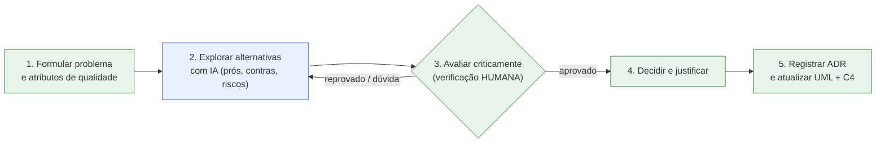
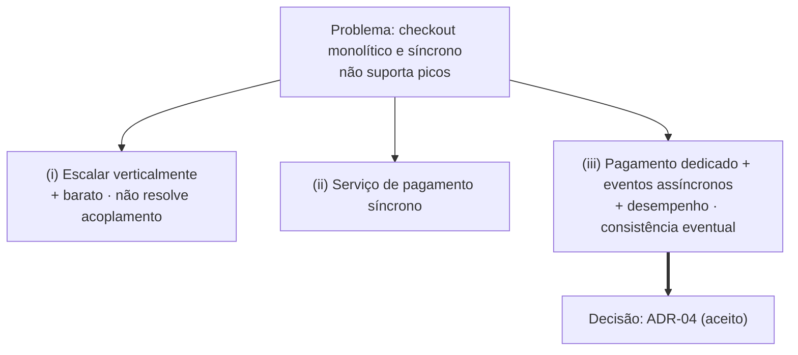
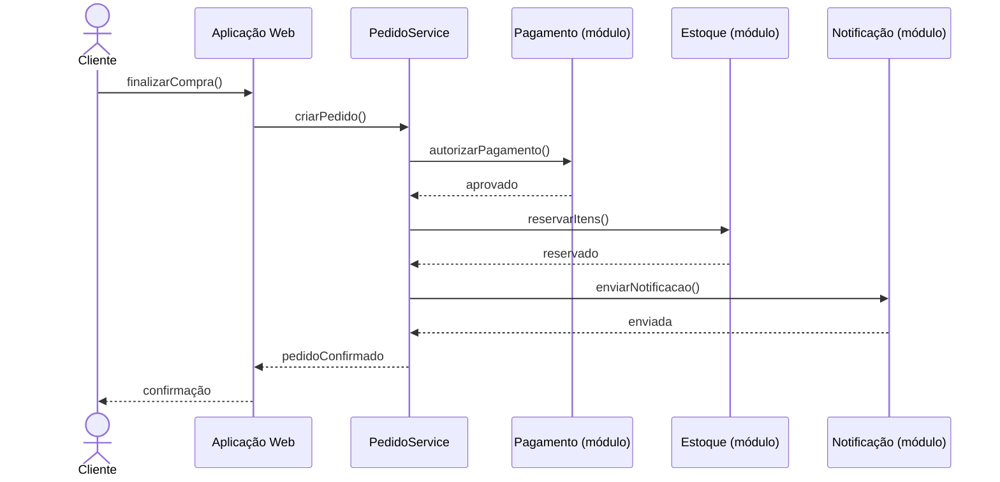
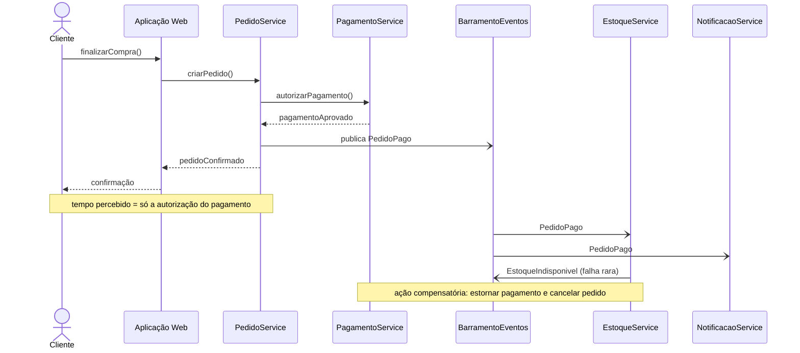

# Aula 5 — Modelagem e Registro de Decisões Arquiteturais com Apoio de IA

> *Aula 5 — Prof. Nataniel Paiva · Curso: Arquitetura de Sistemas e Microsserviços · Unidade 1*

Estudo de caso que integra **UML, C4 e ADR** contando a história completa de uma decisão arquitetural: **problema → alternativas (com apoio de IA) → avaliação crítica → [ADR-04](adr/ADR-04-desacoplamento-assincrono.md) → diagramas atualizados**.

## Fluxo de decisão

Azul = apoio da IA · Verde = passos humanos. Detalhes em [docs/03](docs/03-fluxo-em-5-etapas.md).

## O problema

Na Black Friday o checkout do monolito fica lento/indisponível: pagamento, reserva de estoque e notificações rodam de forma síncrona e sequencial. Ver [docs/01](docs/01-cenario-e-problema.md).

## Alternativas

## Antes × depois: sequência

**Antes** (síncrono e sequencial):

**Depois** (autorização síncrona; estoque e notificações assíncronos — `->>` síncrono, `-)` assíncrono):

Estados do Pedido e C4 nível 2 (antes/depois) em [docs/05](docs/05-atualizacao-dos-diagramas.md).

## Custo aceito

Consistência eventual (estoque/notificações) + ação compensatória (`EstoqueIndisponivel` → estorno e cancelamento) + observabilidade adicional.

## Mapa do repositório

| Caminho | Conteúdo |
|---|---|
| [docs/](docs/) | Cenário, IA, fluxo, alternativas, diagramas, rastreabilidade |
| [adr/](adr/ADR-04-desacoplamento-assincrono.md) | ADR-04 |
| [diagramas/](diagramas/) | Fontes `.mmd` antes/depois |
| [prompts/](prompts/) | Prompts de exemplo com verificação humana |
| [checklist-verificacao-humana.md](checklist-verificacao-humana.md) | Checklist |
| [docs/briefing.md](docs/briefing.md) | Briefing original |

> Tecnologias de broker/banco não foram especificadas nos slides; usamos rótulos genéricos (*exemplo adicional*).
