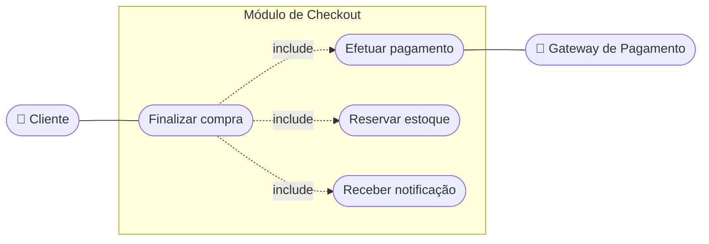

# 01 — Cenário e problema

Sistema de e-commerce (módulo de checkout, casos de uso da Aula 2). Na **Black Friday** o checkout fica lento ou indisponível porque **pagamento, reserva de estoque e notificações** executam de forma **síncrona e sequencial** em um monolito.

Objetivo: evoluir sem comprometer a **consistência dos dados de pagamento**. Atributos priorizados: desempenho, disponibilidade e consistência (forte no pagamento).

*Exemplo adicional* — casos de uso aproximados em flowchart:

Decisão resultante: [ADR-04](../adr/ADR-04-desacoplamento-assincrono.md).
