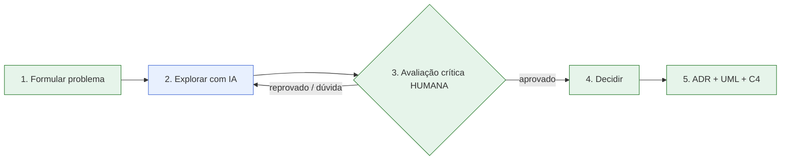

# 03 — Fluxo em 5 etapas

| # | Etapa | Quem |
|---|---|---|
| 1 | Formular o problema e os atributos de qualidade | Humano |
| 2 | Explorar alternativas pedindo prós, contras e riscos | **IA** (com humano) |
| 3 | **Avaliar criticamente**: fatos técnicos, custos, riscos, vieses (documentação oficial, testes de carga, especialistas) | Humano — **nunca opcional** |
| 4 | Decidir e justificar | Humano |
| 5 | Registrar em ADR e atualizar UML + C4 | Humano (IA pode revisar) |

> Sem a etapa 3, a IA deixa de ser "apoio à decisão" e vira delegação irresponsável.
