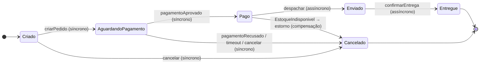
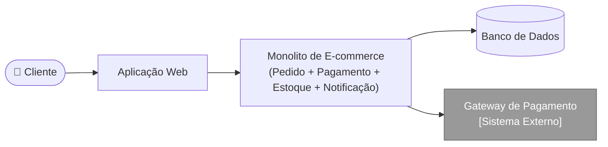
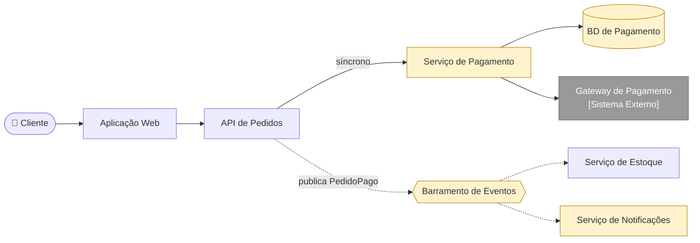

# 05 — Atualização dos diagramas (antes × depois)

Todos referenciam o [ADR-04](../adr/ADR-04-desacoplamento-assincrono.md). Fontes em [`diagramas/`](../diagramas/).

## Sequência

- Antes: [`antes/sequencia-checkout.mmd`](../diagramas/antes/sequencia-checkout.mmd) — tudo síncrono e sequencial.
- Depois: [`depois/sequencia-checkout.mmd`](../diagramas/depois/sequencia-checkout.mmd) — pagamento síncrono; estoque e notificação assíncronos; novas linhas de vida `PagamentoService` e `BarramentoEventos`. Diagrama completo no [README](../README.md).

## Máquina de estados do Pedido (continua válida)

A transição `Pago → Cancelado` por compensação é **consequência documentada do ADR-04**.

| Transição | Evento | Tipo |
|---|---|---|
| Criado → AguardandoPagamento | `criarPedido` | síncrono |
| AguardandoPagamento → Pago | `pagamentoAprovado` | síncrono (consistência forte) |
| Criado/AguardandoPagamento → Cancelado | `pagamentoRecusado / timeout` ou `cancelar` | síncrono |
| Pago → Enviado | `despachar` | assíncrono (evento no barramento) |
| Enviado → Entregue | `confirmarEntrega` | assíncrono (evento da transportadora) |
| Pago → Cancelado | `EstoqueIndisponivel` | compensação (estorno) |

## C4 nível 2

**Antes** (*exemplo adicional*, rótulos genéricos):

**Depois** (novos em amarelo): `Serviço de Pagamento` (BD próprio, único que fala com o gateway), `Barramento de Eventos`, `Serviço de Notificações`.

Versão `C4Container`: [`depois/c4-conteineres.mmd`](../diagramas/depois/c4-conteineres.mmd).
