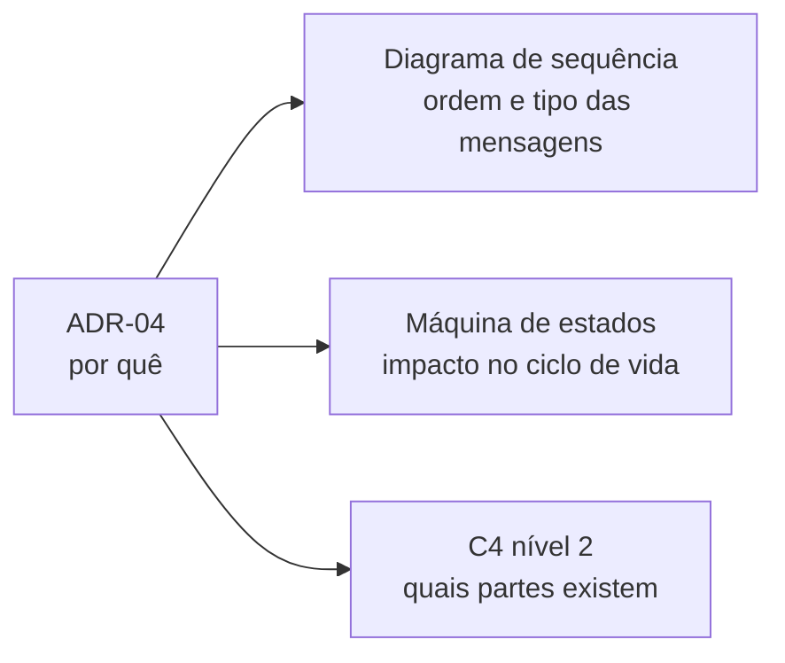

# 06 — Rastreabilidade

| Artefato | Link |
|---|---|
| ADR-04 | [adr/ADR-04-desacoplamento-assincrono.md](../adr/ADR-04-desacoplamento-assincrono.md) |
| Sequência | [diagramas/depois/sequencia-checkout.mmd](../diagramas/depois/sequencia-checkout.mmd) |
| Estados | [diagramas/depois/pedido-estados.mmd](../diagramas/depois/pedido-estados.mmd) |
| C4 | [diagramas/depois/c4-conteineres.mmd](../diagramas/depois/c4-conteineres.mmd) |

Os três artefatos contam a mesma história em níveis diferentes; o ADR explica o porquê. Versionados juntos com o código, mantêm a documentação coerente.
