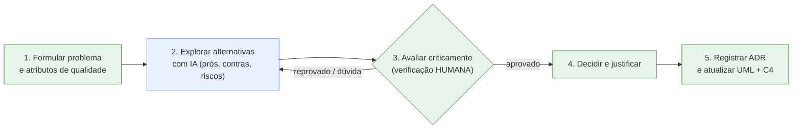
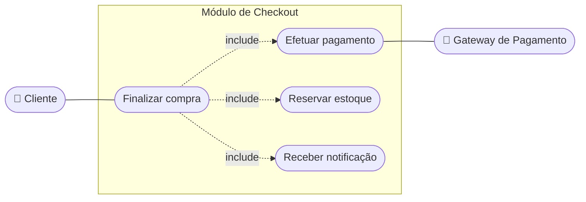
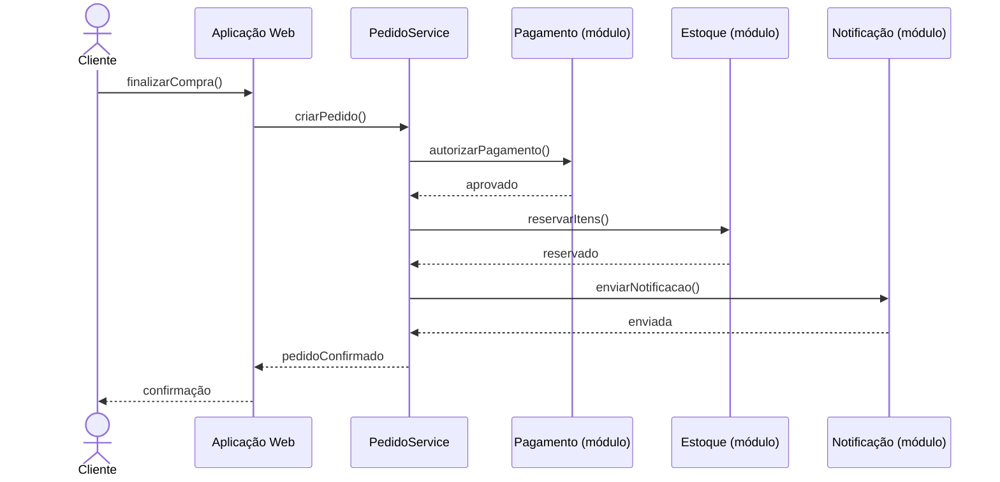
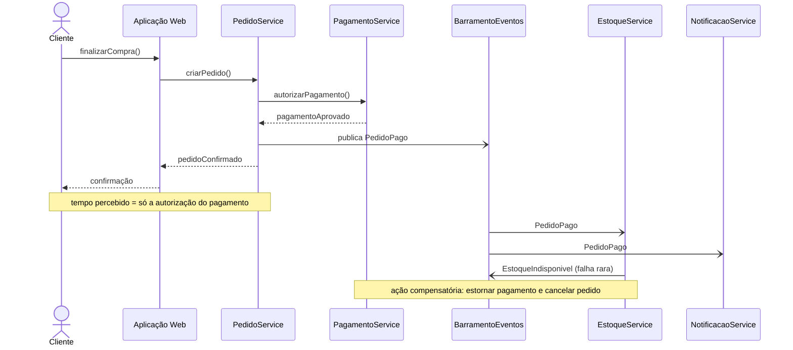
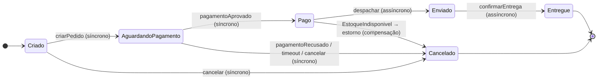
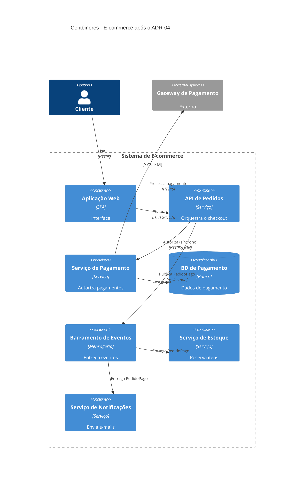
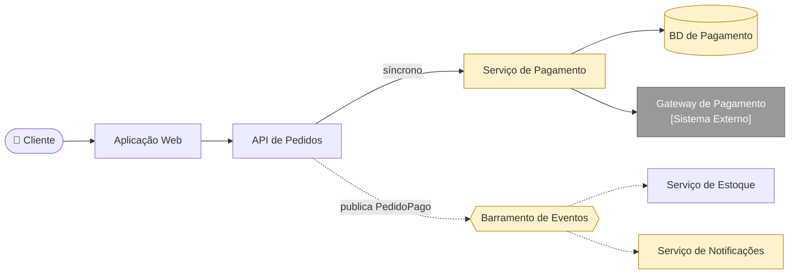
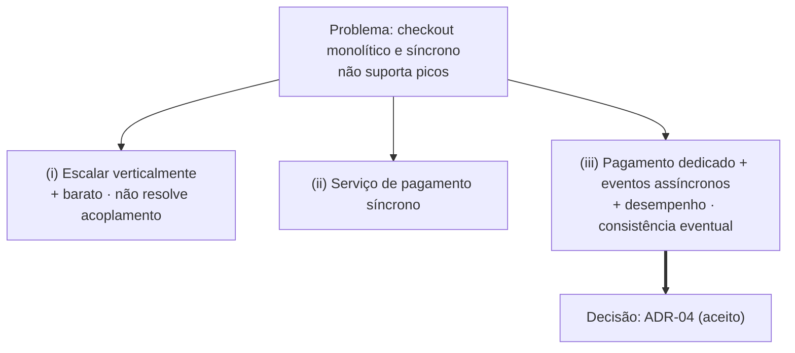
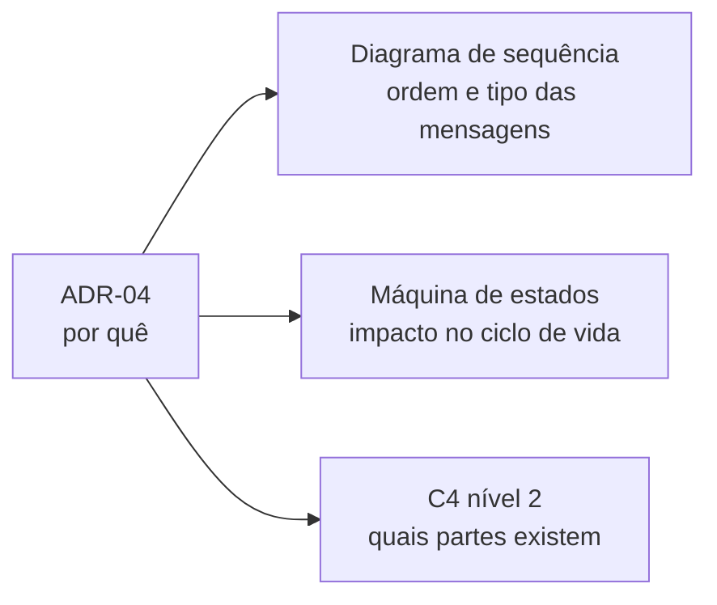

# Aula 5 — Estudo de Caso: Modelagem e Registro de Decisões Arquiteturais com Apoio de IA

> **Curso:** Arquitetura de Sistemas e Microsserviços · **Unidade 1 · Aula 5** · Prof. Nataniel Paiva
> **Fonte:** `Aula5_..._Estudo de Caso Modelagem e Registro de Decisões Arquiteturais com Apoio de IA_unidade01_aula05.pptx` (50 slides)

Este README é um **briefing para outra IA** criar um projeto visual de estudo de caso que integra toda a Unidade 1 (UML, C4 e ADR). O conteúdo vem dos slides; os diagramas Mermaid são **exemplos prontos** para renderizar no GitHub.

---

## 1. Objetivo do projeto a ser gerado

Um repositório que conte **a história completa de uma decisão arquitetural**: problema → alternativas (com apoio de IA) → avaliação crítica → **ADR-04** → atualização dos diagramas (sequência, máquina de estados, C4). Deve mostrar o **antes e o depois** de cada diagrama.

**Idioma:** PT-BR. **Tom:** didático, mostrando rastreabilidade entre os artefatos.

## 2. Resumo do conteúdo (fonte de verdade)

### 2.1 Cenário
Sistema de e-commerce (diagrama de casos de uso da Aula 2, módulo de checkout). Na **Black Friday** o checkout fica lento/indisponível porque **pagamento, reserva de estoque e notificações** rodam de forma **síncrona e sequencial** em um monolito. Decisão: evoluir sem comprometer a **consistência dos dados de pagamento**.

### 2.2 IA generativa no apoio arquitetural
**Ajuda em:** rascunho de diagrama C4/UML a partir de texto; sugerir alternativas com prós/contras; apontar riscos/atributos de qualidade esquecidos; revisar ADR (lacunas e inconsistências).
**Exige verificação crítica:** *alucinações* (afirmações incorretas com confiança), *vieses* (ex.: preferir fornecedor sem justificativa), *segurança* (ex.: dados sensíveis em logs/eventos), *propriedade intelectual*. **A responsabilidade final é integralmente humana.**

### 2.3 Fluxo em 5 etapas
1. Formular o problema e os atributos de qualidade.
2. Explorar alternativas com IA (pedindo prós, contras e riscos).
3. **Avaliar criticamente** (fatos técnicos, custos, riscos, vieses) — etapa **não opcional**: confirmar com documentação oficial, testes de carga, especialistas.
4. Decidir e justificar (julgamento humano).
5. Registrar em ADR e atualizar UML + C4.

> Sem a etapa 3, a IA deixa de ser "apoio à decisão" e vira delegação irresponsável.

### 2.3.1 Alternativas exploradas
| # | Alternativa | Observação da IA |
|---|---|---|
| i | Manter monolito, escalar **verticalmente** nos picos | menor custo, **não resolve acoplamento temporal** |
| ii | Serviço de pagamento dedicado, comunicação **síncrona** | — |
| iii | Serviço de pagamento dedicado, **assíncrona por eventos** com estoque/notificações; **autorização continua síncrona** | introduz **consistência eventual**; exige tratar falhas de entrega de eventos |

**Escolhida: (iii)**, após a equipe verificar que a mensageria sugerida pela IA é compatível com a nuvem já contratada.

### 2.4 ADR-04
- **Título:** ADR-04, Desacoplamento assíncrono entre Pagamento, Estoque e Notificações
- **Status:** aceito
- **Contexto:** priorizados desempenho e disponibilidade sob pico; consistência eventual aceitável para estoque e notificações, **não** para a autorização do pagamento
- **Decisão:** autorização de pagamento **síncrona**; atualização de estoque e notificações por **eventos assíncronos**
- **Consequências:** exige observabilidade adicional para rastrear eventos entre serviços; possível **ação compensatória** (ex.: evento `EstoqueIndisponivel` → estornar pagamento e cancelar pedido)

### 2.5 Impacto nos artefatos
- **Sequência:** pagamento síncrono; estoque e notificação assíncronos. Novas linhas de vida: `PagamentoService` e `BarramentoEventos`.
- **Máquina de estados do Pedido:** continua válida; cada transição passa a indicar se é disparada por evento síncrono ou assíncrono.
- **C4 nível 2:** `Serviço de Pagamento` (BD próprio, único que fala com o gateway externo) e `Barramento de Eventos` viram contêineres; novo `Serviço de Notificações` assume e-mails.
- Os três artefatos contam a mesma história em níveis diferentes; o **ADR explica o porquê**. Versionados juntos com o código → documentação coerente e rastreável.

---

## 3. Exemplos Mermaid (renderizam no GitHub)

### 3.1 Fluxo de decisão com apoio de IA



### 3.2 Casos de uso do checkout (Aula 2) — aproximação em flowchart

O Mermaid não possui diagrama de casos de uso nativo; este é um exemplo ilustrativo (*exemplo adicional*, o original está nos slides):



### 3.3 Sequência ANTES do ADR-04 (síncrono e sequencial)



### 3.4 Sequência DEPOIS do ADR-04 (autorização síncrona; resto assíncrono)



> Setas `->>` = síncrona · `-)` = assíncrona (fire-and-forget). Se a versão do Mermaid não suportar `-)`, usar `--)`.

### 3.5 Máquina de estados do Pedido anotada (síncrono × assíncrono)



> A última transição (`Pago → Cancelado` por compensação) decorre do texto dos slides sobre falha de estoque após o pagamento; marque-a como **consequência documentada do ADR-04**.

### 3.5.1 Tabela de transições

| Transição | Evento | Tipo |
|---|---|---|
| Criado → AguardandoPagamento | `criarPedido` | síncrono |
| AguardandoPagamento → Pago | `pagamentoAprovado` | síncrono (consistência forte) |
| Criado/AguardandoPagamento → Cancelado | `pagamentoRecusado / timeout` ou `cancelar` | síncrono |
| Pago → Enviado | `despachar` | assíncrono (evento no barramento) |
| Enviado → Entregue | `confirmarEntrega` | assíncrono (evento da transportadora) |

### 3.6 C4 nível 2 DEPOIS do ADR-04



Alternativa em flowchart:



### 3.7 Alternativas avaliadas (matriz de decisão)



### 3.8 Rastreabilidade ADR ↔ diagramas



### 3.9 Template de ADR (copiar para `adr/ADR-04-....md`)

````markdown
# ADR-04: Desacoplamento assíncrono entre Pagamento, Estoque e Notificações

- **Status:** aceito
- **Contexto:** desempenho e disponibilidade sob pico; consistência eventual aceitável
  para estoque e notificações, mas não para a autorização do pagamento.
- **Decisão:** manter a autorização de pagamento síncrona; mover estoque e notificações
  para comunicação assíncrona baseada em eventos.
- **Consequências:** exige observabilidade adicional (rastrear eventos); falhas como
  `EstoqueIndisponivel` exigem ação compensatória (estorno + cancelamento).
- **Alternativas consideradas:** (i) escala vertical; (ii) pagamento síncrono dedicado.
- **Diagramas atualizados:** sequência do checkout, máquina de estados do Pedido, C4 nível 2.
````

---

## 4. Estrutura sugerida do projeto a gerar

```
aula5-projeto/
├── README.md                      # a história da decisão, com antes/depois
├── docs/
│   ├── 01-cenario-e-problema.md
│   ├── 02-ia-no-apoio-arquitetural.md   # possibilidades × limites
│   ├── 03-fluxo-em-5-etapas.md
│   ├── 04-alternativas.md
│   ├── 05-atualizacao-dos-diagramas.md  # sequência, estados, C4 (antes/depois)
│   └── 06-rastreabilidade.md
├── adr/
│   └── ADR-04-desacoplamento-assincrono.md
├── diagramas/
│   ├── antes/  sequencia-checkout.mmd, c4-conteineres.mmd
│   └── depois/ sequencia-checkout.mmd, pedido-estados.mmd, c4-conteineres.mmd
├── prompts/                        # exemplos de prompts para IA (ver §5)
└── checklist-verificacao-humana.md
```

**Pasta `prompts/` sugerida (exemplo adicional):** prompt para explorar alternativas pedindo prós/contras/riscos; prompt para revisar ADR; prompt para rascunhar C4 a partir de texto — cada um com **lista de verificação humana** (documentação oficial, teste de carga, vieses de fornecedor, dados sensíveis em eventos, propriedade intelectual).

## 5. Regras para a IA que for gerar o projeto

1. **Mostre antes × depois** lado a lado para sequência e C4; destaque o que é novo.
2. **A IA é apoio, não decisora:** em todo fluxo, marque quais passos são da IA e quais são humanos (a verificação nunca é opcional).
3. **Mermaid:** ```` ```mermaid ````; `->>` síncrono, `-)` assíncrono; testar a renderização; manter alternativa em flowchart para C4.
4. **Não invente tecnologias** (broker, banco): onde os slides não especificam, use rótulos genéricos ("Mensageria", "Banco") e marque como *"exemplo adicional"*.
5. **Cada diagrama referencia o ADR-04** e vice-versa (rastreabilidade); tudo versionado como texto.
6. Documente o **custo aceito**: consistência eventual + ação compensatória + observabilidade.
7. Citar: *Aula 5 — Prof. Nataniel Paiva*.

## 6. Checklist de aceitação

- [ ] Fluxo de 5 etapas com a verificação humana destacada
- [ ] Três alternativas com prós/contras e a escolhida
- [ ] ADR-04 completo (status, contexto, decisão, consequências)
- [ ] Sequência antes/depois com setas síncronas e assíncronas
- [ ] Máquina de estados anotada + tabela de transições
- [ ] C4 nível 2 com `Serviço de Pagamento`, `Barramento de Eventos` e `Serviço de Notificações`
- [ ] Ação compensatória (`EstoqueIndisponivel`) documentada
- [ ] Renderização validada no GitHub
